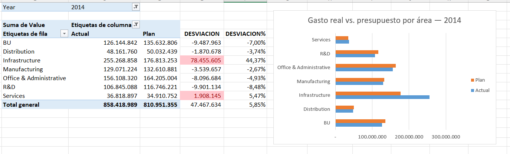
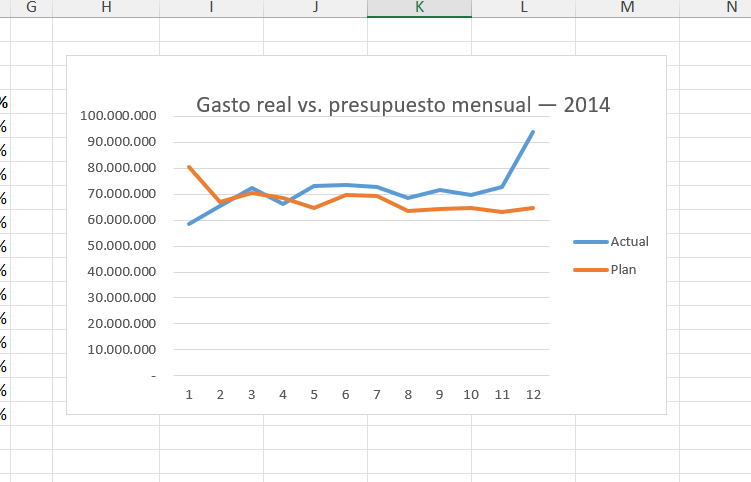
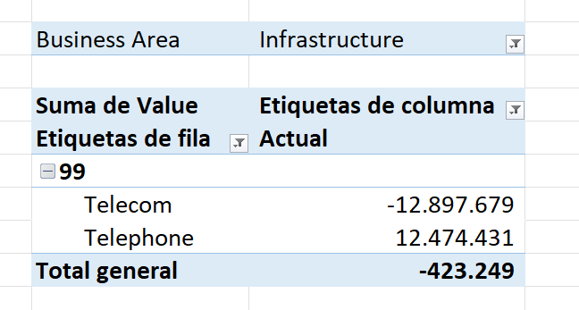

# Análisis de gastos vs. presupuesto — 2014

Proyecto de aprendizaje de Javier Briceño Jiménez para comparar gasto real y presupuesto en Excel, identificar desviaciones y documentar hallazgos.

## Objetivo

Responder qué áreas y períodos concentran las diferencias entre gasto real y presupuesto, y distinguir los resultados comprobados de las causas que requieren validación contable.

## Mi aporte

Sobre el modelo de datos de muestra de Microsoft/obviEnce, construí las tablas dinámicas por área y período, las fórmulas de desviación, el formato condicional, los gráficos y la hoja de hallazgos. Exploré las relaciones existentes en Power Pivot e investigué presupuestos vacíos y saldos negativos.

El modelo y los datos originales fueron proporcionados por la fuente. El ejercicio se realizó con orientación de IA; la construcción del análisis en Excel fue realizada por mí. Esta versión no incluye desarrollo propio en SQL ni preparación de datos mediante Power Query.

## Resultados de 2014

Importes en las unidades numéricas de la muestra; moneda y escala de origen pendientes de confirmar. No se presentan como pesos chilenos.

| Indicador | Resultado |
|---|---:|
| Gasto real | 858.418.988,84 |
| Presupuesto | 810.951.355,08 |
| Desviación anual | +47.467.633,76 |
| Desviación anual porcentual | +5,85 % |
| Desviación de Infrastructure | +78.455.604,93 (+44,37 %) |
| Desviación de diciembre | +29.300.032,07 (+45,35 %) |

Diciembre concentra aproximadamente el 61,7 % de la desviación anual neta. Infrastructure supera por sí sola la desviación anual total, parcialmente compensada por áreas con gasto inferior al presupuesto.

## Visualizaciones

### Resumen por área

Fuente de los datos y modelo: Microsoft/obviEnce. obviEnce ©.

### Evolución mensual

Fuente de los datos y modelo: Microsoft/obviEnce. obviEnce ©.

### Investigación de diferencias

En el departamento 99 de Infrastructure, Telephone registra 12.474.430,68 y Telecom registra −12.897.679,20. El saldo conjunto es −423.248,52. La compensación parcial sugiere una hipótesis de reclasificación o asignación interna, pero no confirma su causa.

Fuente de los datos y modelo: Microsoft/obviEnce. obviEnce ©.

## Metodología

- Período: 2014.
- Actual: importe real registrado. Plan: presupuesto.
- Desviación = Actual − Plan.
- Desviación % = (Actual − Plan) / Plan.
- El porcentaje total se calcula con los totales, no sumando porcentajes individuales.
- Se mantiene el signo original de los datos. Un importe real negativo no se interpreta automáticamente como ahorro.
- Un presupuesto vacío no se considera automáticamente un presupuesto aprobado de cero.

## Validación y límites

Se revisaron las fórmulas guardadas de desviación y porcentaje y se conciliaron los totales mensuales y por área. Los resultados almacenados de los gráficos corresponden a las siete áreas y los doce períodos, sin incluir los totales como categoría.

La actualización completa del modelo en Excel está pendiente de verificar. El libro conserva una referencia externa al archivo original, asociada a su hoja Info; las fórmulas de desviación revisadas usan celdas del propio libro. Las causas contables de presupuestos negativos y posibles reclasificaciones no pueden confirmarse sin documentación adicional.

## Fuente y atribución

[IT Spend Analysis — Microsoft Learn](https://learn.microsoft.com/en-us/power-bi/create-reports/sample-it-spend).

[Archivo de muestra original](https://github.com/microsoft/powerbi-desktop-samples/blob/main/powerbi-service-samples/IT%20Spend%20Analysis%20Sample-no-PV.xlsx).

[Condiciones de uso de las muestras](https://learn.microsoft.com/en-us/power-bi/create-reports/sample-datasets#legal-guidelines-for-using-samples).

Los libros y datos de muestra son propiedad de obviEnce, LLC y se comparten para demostrar las funcionalidades de Power BI con datos de ejemplo de la industria. **obviEnce ©**.

## Descargar el análisis

[Descargar el libro de Excel](excel/Analisis_Gastos_vs_Presupuesto_2014.xlsx?raw=true).

El libro incluye el modelo de Power Pivot y los resultados guardados. Para explorar las tablas dinámicas, se recomienda Excel de escritorio con compatibilidad con el modelo de datos. No requiere conexión a sistemas de FEMSA ni contiene datos laborales del autor.

Se conserva el vínculo heredado a la hoja Info del archivo original como limitación documentada; no se garantiza la actualización de todas las conexiones. Las capturas permiten consultar los resultados sin abrir Excel.

El material de origen conserva la licencia MIT de Microsoft en LICENSE-MICROSOFT.txt y la atribución obviEnce ©. Las modificaciones de análisis se describen en Mi aporte.
